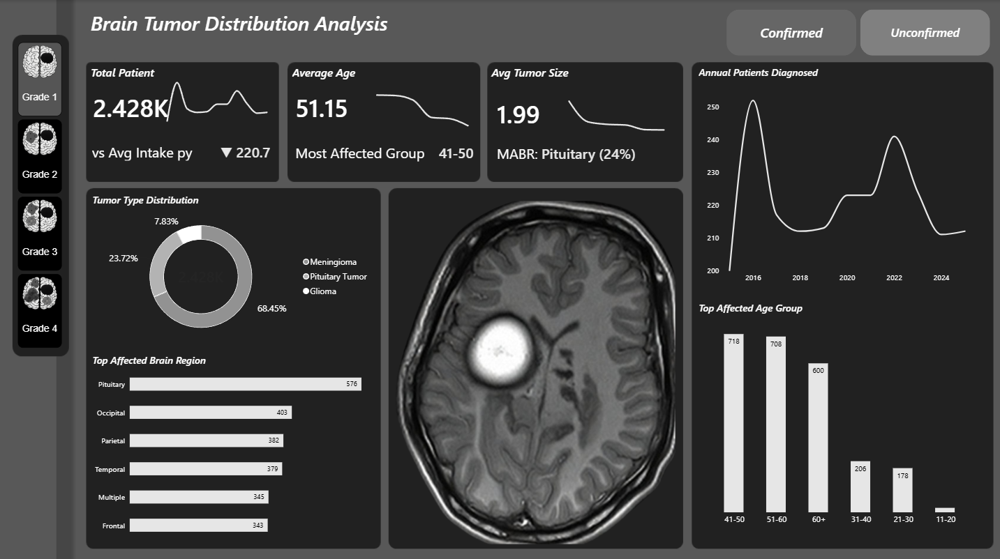

# 🧠 Brain Tumor Distribution Analysis

An interactive **Power BI** dashboard exploring patient demographics, tumor types and affected brain regions across **3,667 patient records**.


---

## 📌 Table of Contents

- [Overview](#-overview)
- [Dashboard Preview](#-dashboard-preview)
- [Repository Files](#-repository-files)
- [Project Details](#-project-details)
- [Data Model](#-data-model)
- [Visuals](#-visuals)
- [DAX Reference](#-dax-reference)
- [Key Findings](#-key-findings)
- [How to Use](#-how-to-use)
- [Getting Started](#-getting-started)
- [Notes and Possible Improvements](#-notes-and-possible-improvements)

---

## 🎯 Overview

This project analyses how brain tumor cases are distributed across patient age groups, tumor types, affected brain regions and years of diagnosis. The dashboard gives a single-screen view of who is affected, where tumors occur and how case volumes change over time, with MRI imagery and tumor-grade icons keeping the clinical context visible.

### Objectives

- Summarise the patient population through three KPI cards: **total patients**, **average age** and **average tumor size**.
- Show how cases split between tumor types (**Glioma** and **Medulloblastoma**).
- Identify the **most affected brain regions** and **age groups**.
- Track the number of patients **diagnosed each year** to reveal trends.
- Let users filter by **diagnosis status** (confirmed / unconfirmed) and **tumor grade**.

---

## 🖼️ Dashboard Preview



The page follows a left-to-right reading flow: filters sit at the edges, KPI cards form the top row, and the supporting breakdowns sit below around the central MRI image.

| Zone | Component | Visual Type |
| --- | --- | --- |
| Left sidebar | Tumor Grade slicer (Grade 1 to 4) | Chiclet Slicer |
| Top right | Confirmed / Unconfirmed toggle | Button slicer |
| Top row | Total Patient, Average Age, Avg Tumor Size | Card + sparkline + reference label |
| Middle left | Tumor Type Distribution | Donut chart |
| Bottom left | Top Affected Brain Region | Clustered bar chart |
| Centre | MRI scan image | Image visual (cloudScope) |
| Right, upper | Annual Patients Diagnosed | Line chart |
| Right, lower | Top Affected Age Group | Clustered column chart |

---

## 📁 Repository Files

| File | Description |
| --- | --- |
| `project.pbix` | Power BI report file (open in Power BI Desktop) |
| `Brain Tumor Data.csv` | Fact table with patient records |
| `Tumor Images.csv` | Supporting table with grade icons and MRI image URLs |
| `Brain_Tumor_Project_Documentation.docx` | Full project documentation |
| `dashboard_preview.png` | Screenshot of the finished dashboard |
| `README.md` | Project overview (this file) |

---

## 🛠️ Project Details

| Item | Details |
| --- | --- |
| Tool | Microsoft Power BI Desktop |
| Source file | `project.pbix` |
| Report canvas | Single page, 1920 × 1080 px (Fit to page), dark grayscale theme |
| Fact table | `Brain Tumor Data` |
| Supporting table | `Tumor Images` |
| Custom visuals | Chiclet Slicer, Image visual (cloudScope) |
| Theme | Fluent 2 base theme, white-on-charcoal styling, custom background image |
| Calculated column | `Age Group` (10-year bands) |
| DAX measures | `Avg Intake py`, `vs Avg Intake py`, `Most Affected Group`, `MABR` |

---

## 🗂️ Data Model

### `Brain Tumor Data` (fact table)

| Field | Kind | Used For |
| --- | --- | --- |
| Patient ID | Column | Distinct count in every patient-count visual and KPI |
| Age | Column | Average Age card; source for Age Group |
| Age Group | Calculated column | Age-group sparkline, Top Affected Age Group chart, Most Affected Group measure |
| Date of Diagnosis | Column (year level) | Total Patient sparkline, Annual Patients chart, Avg Intake py |
| Tumor Type | Column | Donut chart legend |
| Tumor Size (cm) | Column | Average Tumor Size card and sparkline |
| Affected Brain Region | Column | Top Affected Brain Region chart, sparkline, MABR measure |
| Histology Confirmation | Column | Confirmed / Unconfirmed slicer |

### `Tumor Images` (supporting table)

| Field | Kind | Used For |
| --- | --- | --- |
| Tumor Grade | Column | Category of the Chiclet grade slicer |
| Icon URL | Column | Brain icon on each grade button |
| Image URL | Column | MRI scan shown in the centre of the page |

---

## 📊 Visuals

### KPI Card Pattern

Each of the three KPI cards is built from three layered visuals so one tile shows a headline number, a trend and a context label:

1. **Main card** – the headline metric.
2. **Sparkline line chart** – axes and gridlines hidden, placed beside the number to show the trend.
3. **Reference-label card** – a second card using Patient ID (count) with a reference label bound to a measure; the card's own value and label are switched off so only the reference label remains.

| KPI Card | Main Value | Sparkline | Reference Label |
| --- | --- | --- | --- |
| **Total Patient** | Patient ID (distinct count) | X = Date of Diagnosis (year), Y = Patient ID (count) | `vs Avg Intake py` |
| **Average Age** | Age (average) | X = Age Group, Y = Patient ID (count) | `Most Affected Group` |
| **Avg Tumor Size** | Tumor Size (cm) (average) | X = Affected Brain Region, Y = Tumor Size (sum) | `MABR` |

### Other Visuals

| Visual | Type | Fields |
| --- | --- | --- |
| Diagnosis Status Toggle | Button slicer | Histology Confirmation |
| Tumor Grade Slicer | Chiclet Slicer | Category = Tumor Grade, Image = Icon URL |
| MRI Scan | Image visual (cloudScope) | Image URL |
| Tumor Type Distribution | Donut chart | Legend = Tumor Type, Values = Patient ID (count) |
| Top Affected Brain Region | Clustered bar chart | Y = Affected Brain Region, X = Patient ID (count) |
| Annual Patients Diagnosed | Line chart | X = Date of Diagnosis (year), Y = Patient ID (count) |
| Top Affected Age Group | Clustered column chart | X = Age Group, Y = Patient ID (count) |

---

## 🧮 DAX Reference

<details>
<summary><b>Age Group</b> (calculated column)</summary>

Bins patient age into 10-year bands. Anything that matches no band returns `"Unknown"`, making bad or missing ages easy to spot.

```dax
Age Group =
VAR AgeValue = 'Brain Tumor Data'[Age]
RETURN
SWITCH(
    TRUE(),
    AgeValue >= 0 && AgeValue <= 10, "0-10",
    AgeValue >= 11 && AgeValue <= 20, "11-20",
    AgeValue >= 21 && AgeValue <= 30, "21-30",
    AgeValue >= 31 && AgeValue <= 40, "31-40",
    AgeValue >= 41 && AgeValue <= 50, "41-50",
    AgeValue >= 51 && AgeValue <= 60, "51-60",
    AgeValue > 60, "60+",
    "Unknown"
)
```
</details>

<details>
<summary><b>Avg Intake py</b> (measure)</summary>

Average number of patients admitted per year in the current filter context. `DIVIDE` returns blank instead of an error if the year count is zero.

```dax
Avg Intake py =
VAR _StartYear =
    YEAR ( MIN ( 'Brain Tumor Data'[Date of Diagnosis] ) )
VAR _EndYear =
    YEAR ( MAX ( 'Brain Tumor Data'[Date of Diagnosis] ) )
VAR _NumYears = _EndYear - _StartYear + 1
VAR _TotalPatients =
    CALCULATE ( COUNTROWS ( 'Brain Tumor Data' ) )
RETURN
    DIVIDE ( _TotalPatients, _NumYears )
```
</details>

<details>
<summary><b>vs Avg Intake py</b> (text measure)</summary>

Compares the yearly intake under the current slicer selection with the overall average (`ALL` removes every filter). Returns the current intake prefixed with ▲ (above overall), ▼ (below overall) or no symbol (equal).

```dax
vs Avg Intake py =
VAR _CurrentIntake =
    [Avg Intake py]
VAR _OverallIntake =
    CALCULATE (
        [Avg Intake py],
        ALL ( 'Brain Tumor Data' )
    )
VAR _Diff = _CurrentIntake - _OverallIntake
RETURN
    SWITCH (
        TRUE(),
        _Diff > 0, UNICHAR(9650) & " " & FORMAT(_CurrentIntake, "0.0"),
        _Diff < 0, UNICHAR(9660) & " " & FORMAT(_CurrentIntake, "0.0"),
        FORMAT(_CurrentIntake, "0.0")
    )
```
</details>

<details>
<summary><b>Most Affected Group</b> (text measure)</summary>

Builds a table of age groups with distinct patient counts, keeps the top one with `TOPN`, and extracts its label with `MAXX` (here, `60+`).

```dax
Most Affected Group =
VAR AgeGroupCounts =
    SUMMARIZE(
        'Brain Tumor Data',
        'Brain Tumor Data'[Age Group],
        "PatientCount", DISTINCTCOUNT('Brain Tumor Data'[Patient ID])
    )
VAR TopGroup =
    TOPN(1, AgeGroupCounts, [PatientCount], DESC)
RETURN
MAXX(TopGroup, 'Brain Tumor Data'[Age Group])
```
</details>

<details>
<summary><b>MABR – Most Affected Brain Region</b> (text measure)</summary>

Counts rows per brain region, keeps the largest, and divides its count by total patients. Returns a readable string such as `Cerebellum (24%)`.

```dax
MABR =
VAR TotalPatients = COUNTROWS('Brain Tumor Data')
VAR RegionCounts =
    SUMMARIZE(
        'Brain Tumor Data',
        'Brain Tumor Data'[Affected Brain Region],
        "Cnt", COUNTROWS('Brain Tumor Data')
    )
VAR TopRegion = TOPN(1, RegionCounts, [Cnt], DESC)
VAR RegionName = MAXX(TopRegion, 'Brain Tumor Data'[Affected Brain Region])
VAR RegionCount = MAXX(TopRegion, [Cnt])
RETURN
RegionName & " (" & FORMAT(DIVIDE(RegionCount, TotalPatients), "0%") & ")"
```
</details>

---

## 🔍 Key Findings

| Metric | Value | Observation |
| --- | --- | --- |
| Total patients | **3,667** | About 333 patients per year on average |
| Average age | **40.45 years** | Cases span all ages, but the 60+ band is the largest |
| Average tumor size | **6.49 cm** | Cerebellum is the most affected region (24% of patients) |
| Tumor type | **Glioma 75.51%**, Medulloblastoma 24.49% | Glioma accounts for roughly three of every four cases |
| Top regions | Cerebellum 898, Occipital 719, Parietal 703, Frontal 676, Temporal 671 | The cerebellum leads by about 180 patients |
| Age groups | 60+: 923; 0-10: 484; 11-20 and 41-50: 468 each; 51-60: 454; 31-40: 443; 21-30: 427 | 60+ has almost twice as many patients as any other band |
| Annual trend | Roughly 280 to 363 patients per year | Peaks around 2016 and 2023, a dip in 2017, and a sharp fall in the final year shown |

---

## 🖱️ How to Use

- **Filter by grade:** click Grade 1 to Grade 4 in the left sidebar.
- **Filter by diagnosis status:** use the Confirmed / Unconfirmed buttons at the top right.
- **Cross-filter:** click a donut slice, bar, column or line-chart point to highlight and filter the other visuals; click again to clear.
- **Read the KPI cards:** the number is the headline metric, the sparkline is its trend, and the small line beneath is the context label.

---

## 🚀 Getting Started

1. Install [Power BI Desktop](https://powerbi.microsoft.com/desktop/) (Windows).
2. Clone this repository:
   ```bash
   git clone https://github.com/sibiallen27/Brain_Tumor_Analysis01.git
   cd Brain_Tumor_Analysis01
   ```
3. Open `project.pbix` in Power BI Desktop.
4. Install the custom visuals if prompted: **Chiclet Slicer** and **Image visual (cloudScope)**.

---

## 📝 Notes and Possible Improvements

- **Latest-year drop:** the annual chart falls sharply in its last year. If that year is incomplete in the source data, flag it on the page or exclude it so it is not read as a real decline.
- **Grade slicer scope:** Tumor Grade lives in the `Tumor Images` table. A relationship (or a grade column) linking it to `Brain Tumor Data` is needed for it to filter patient visuals.
- **Age Group bands:** whole-number boundaries mean an age such as 10.5 would fall into `"Unknown"`. Not an issue if ages are stored as integers.
- **Measure naming:** `vs Avg Intake py` returns the current average rather than a difference; renaming it (e.g. `Intake vs Overall`) may avoid confusion.
- **Distinct count vs row count:** patient visuals use a distinct count of Patient ID, while `Avg Intake py` and `MABR` use `COUNTROWS`. Results match as long as Patient ID is unique per row.
- **Enhancements:** add a year or date-range slicer, tooltips with tumor size by region, and a second page for tumor-size and grade analysis.

---

## 👤 Author

**sibiallen27** – [GitHub Profile](https://github.com/sibiallen27)
